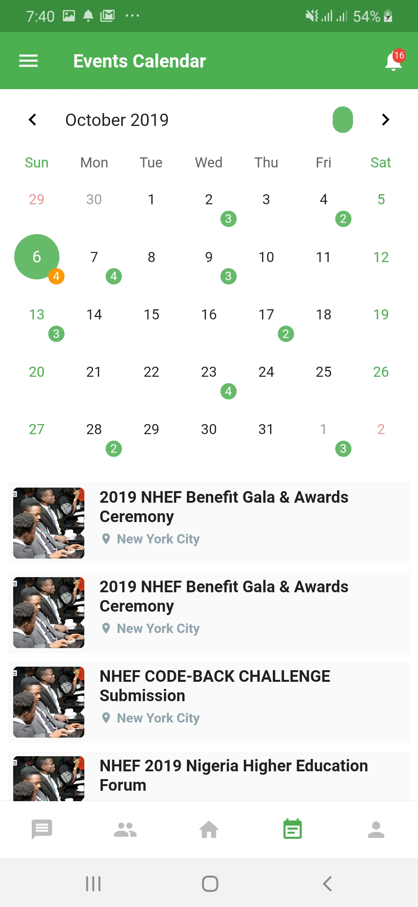
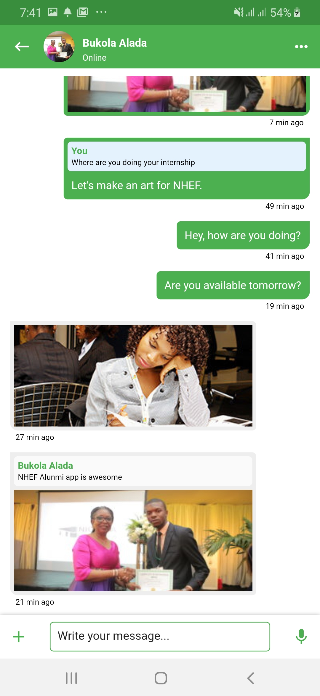
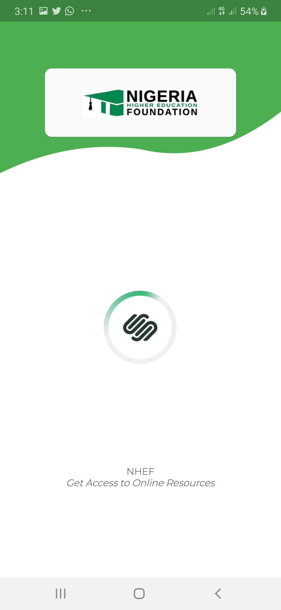
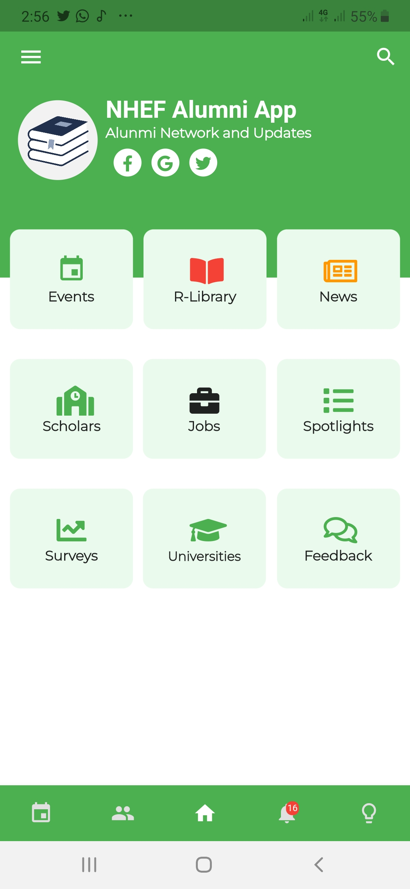
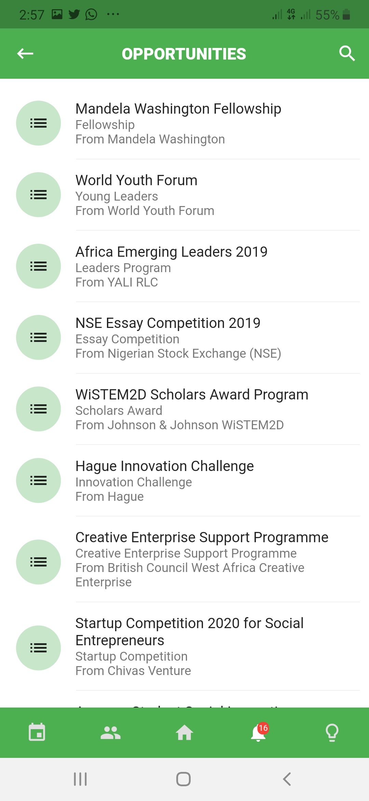

# NHEF Application Challenge

A Cross Platform Mobile Application for NHEF Application Challenge

## Development and security maintenance

Use Flutter **3.7.12** (Dart **2.19.6**) for this legacy, non-null-safe app:

```sh
flutter pub get
flutter test
flutter analyze --no-fatal-infos
```

The HTTP dependency must remain at `0.13.6` or a compatible patched release;
versions below `0.13.3` allow HTTP method/header injection
([GHSA-4rgh-jx4f-qfcq](https://github.com/advisories/GHSA-4rgh-jx4f-qfcq)).
Tests cover rejection of injected HTTP methods, the splash-to-home transition,
and all seven listing requests using a loopback fixture server. They do not
contact the hosted API.

This bounded dependency fix does not migrate the app to Dart 3 or a current
Flutter SDK. Existing APK downloads below predate the fix and must be rebuilt
before distributing a patched application. The Android V1 embedding and existing
analyzer deprecation/unused-import notices remain. Resource and testimonial
previews also retain their existing 45-character minimum description assumption;
the request tests use longer descriptions.

>SCREEN SHOTS v2

<div style="text-align: center"><table><tr>
  <td style="text-align: center">
  
</td>
  <td style="text-align: center">
  
</td>
<td style="text-align: center">

</td>
  <td style="text-align: center">

</td>
</tr></table></div>


>SCREEN SHOTS v1

<div style="text-align: center"><table><tr>
  <td style="text-align: center">
  
</td>
  <td style="text-align: center">
  
</td>
<td style="text-align: center">

</td>
  <td style="text-align: center">

</td>
</tr></table></div>


## Application Features

The Application contains the following source codes:

- Community for Scholars and Mentors
- Events Calendar
- Program Resource Library
- Surveys and Testimonials
- Job and Internship Postings

## Download App

Click the [DOWNLOAD APP](https://github.com/Timtech4u/nhef-app-challenge/blob/master/NHEF%20app.apk) to download the .apk version of the app.

[DOWNLOAD APP](https://github.com/Timtech4u/nhef-app-challenge/blob/master/NHEF%20app.apk)


## Admin Dashboard
 
The Application fetches data from an Admin Dashboard.
 
[Visit Admin Dashboard](https://nhef.herokuapp.com)
Username: `admin`
Password: `pass1234`

  ### Dashboard Features
  - Create, Read, Update, Delete data for all Application Features
  - Export data for Application Features
  - Import data for Application Features
  - Create extra Admin accounts
  - Saves assets to AWS

**[API Documentation](https://nhef.herokuapp.com/api/docs/)**


### Application Features still in progress
-  Scholar Login and Profile
-  Scholar Social Features 
-  Survey Responses Form
-  Event Calendar implementation

